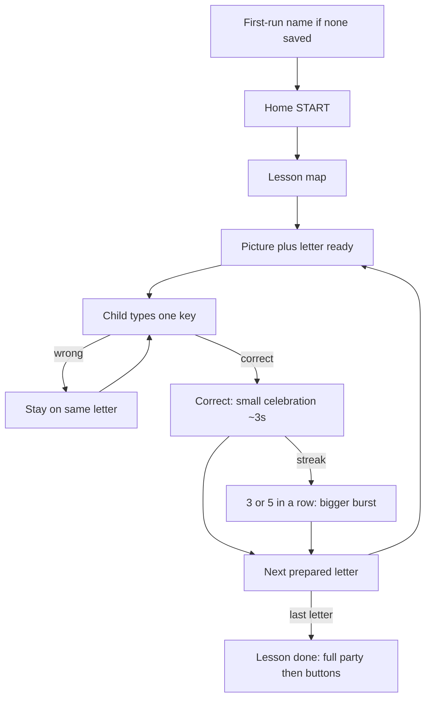

# Keyboard Adventure

A playful typing practice app for children about ages **4–8**. The child sees **one giant letter**, an object that starts with that letter (Fish for F), presses that key, and only then moves on. Wrong keys never skip ahead.

No accounts, ads, analytics, or child data collection. The child’s first name and progress stay in the browser (`localStorage`). The name is never put in the URL or in SEO text.

## What it looks like

Screenshots live in `docs/screenshots/` so GitHub can show them in this README. They are excluded from the Vercel upload (`.vercelignore`) and are **not** in `public/`, so they are not part of the live website.

### Home


### Lesson map


### Lesson

Fish appears before typing F. The toy keyboard has a long space bar. The finger hint stays on screen under the target key.


### Parent settings

Child’s name, Friendly or Calm voice, preview, and speaking speed.




## Install

```bash
cd keyboard-adventure
npm install
```

## Run locally

```bash
npm run dev
```

Open [http://localhost:3000](http://localhost:3000). A computer with a physical keyboard is best for finger practice. Phones use the native keyboard and a compact HUD (no full on-screen QWERTY).

## First visit

If no name is saved, a blocking screen asks **Who is learning today?** A blank name cannot continue. After **LET’S GO!**, the name is stored on this device only. Parent settings can change it later (**▶ Test name**).

## How a lesson works

1. The association picture and word appear **before** typing (Fish / FISH, then F).
2. Typing stays locked for about **0.5 seconds** while the letter zooms in.
3. Voice then says something like: **F is for Fish! Fatima, type F for Fish.** If the same letter comes right after itself: **F, F, Fish!**
4. Only one target is active. Layout never changes what counts as a correct key.
5. First wrong key: sound and shake only. Second: **Almost, Fatima. Find F.** Third: **You can do it, Fatima. Find F.** The picture stays.
6. A correct key locks typing, keeps the picture, and celebrates about **4.5 seconds** so the green letter and sparkles stay on screen.
7. The next letter appears with its picture already ready. Voice does not talk about the next letter until that scene is on screen.
8. Lesson complete is a **full-screen party**. **Next adventure** and **Play again** appear after a few seconds. The app does not leave that screen by itself.

Desktop shows a toy keyboard that still teaches real geography: staggered rows, F/J bumps, and a wide space bar. The finger hint sits under the **target key**, inside the keyboard card.

### Lessons do not skip letters

Lesson 1 is F and J, repeated so the child can practice. Lesson 2 is still F, J, and Space. D and K are lesson 3. **Play again** repeats the same lesson. **Next adventure** then **PLAY** starts the next unlocked lesson.

### Celebrations

| Moment | Feel |
| --- | --- |
| Correct key | Mixed ✨⭐🌸👍👏🎉 around the letter, slow float, ding, 🐻 clap |
| 3 or 5 in a row | Same mix plus 🥳💖 from several screen areas |
| Lesson finished | Whole-screen mix, balloons, confetti, applause once, **YOU DID IT!** |

Reduced motion (OS or parent setting) keeps a still mix of flowers, stars, thumbs, and clap. No flying pieces.

## Voice

Browser speech cannot request `gender: "female"`. The app prefers clearer English system voices (Samantha Enhanced over Compact, and similar). Rate stays near normal talking speed. Parents can preview and pick a voice in settings.

Howler still plays success, wrong, star, streak, and lesson-complete sounds. Applause on lesson complete plays **once**, not in a loop.

## Add lessons

Edit `src/data/lessons.ts`. Each lesson needs an `id`, `title`, `description`, `keys`, and a `sequence` of target characters (`" "` for space).

Lesson 2 unlocks after lesson 1 is finished, and so on.

## Theme and colors

Colors and motion live in `src/app/globals.css`. Fonts are Fredoka (letters) and Nunito (UI) in `src/app/layout.tsx`.

## Checks

```bash
npm run typecheck
npm test
npm run test:e2e
npm run verify
```

## Deploy on Vercel

1. Push this folder to GitHub.
2. Import the repo in Vercel (Next.js defaults).
3. Deploy.

Optional: set `NEXT_PUBLIC_SITE_URL` to the public domain so sitemap, canonical, and Open Graph URLs match production. SEO title, description, robots, sitemap, and JSON-LD are already in the app. They never include the child’s name.

Do **not** copy screenshots into `public/`. GitHub shows `docs/screenshots/` in this README. `.vercelignore` keeps those PNGs out of the Vercel deployment.

## Local progress

These keys are stored only on this device:

- `keyboard-adventure-progress-v1` — completed lessons, stars, attempt counts
- `keyboard-adventure-settings-v1` — child name, sound, voice, volume, animations, hints, question count

Parent settings (gear) → **Reset progress** (lessons, stars, stats) or **Reset everything** (also sound, name, and other options). You can also clear this site’s data in the browser. Nothing is sent to a server.

## How matching works

`src/utils/keys.ts` is the only place that decides if a key counts. Matching is case-insensitive. Held-down repeats (`event.repeat`) are ignored. Modifier and arrow keys are ignored. Space is `event.key === " "`.
