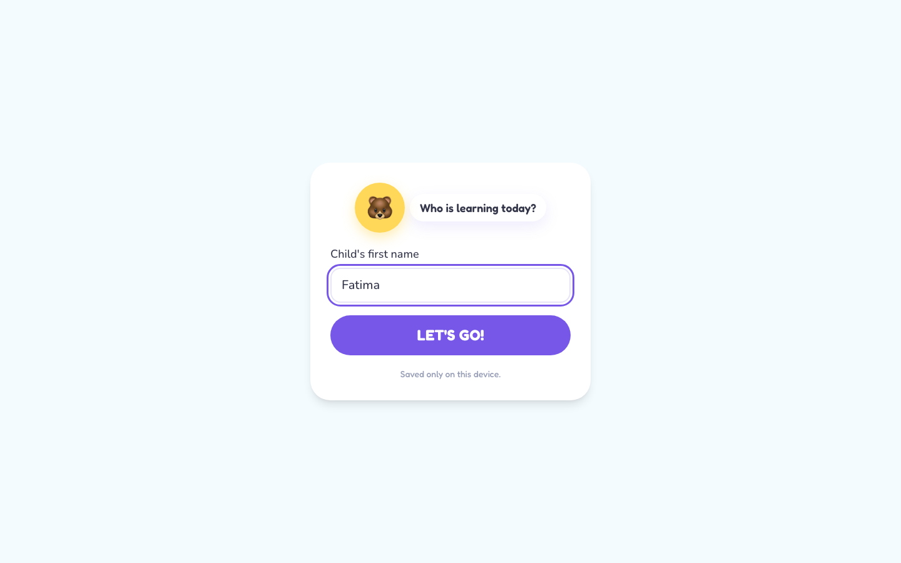
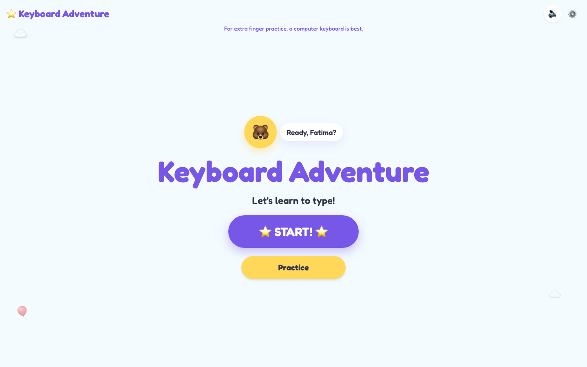
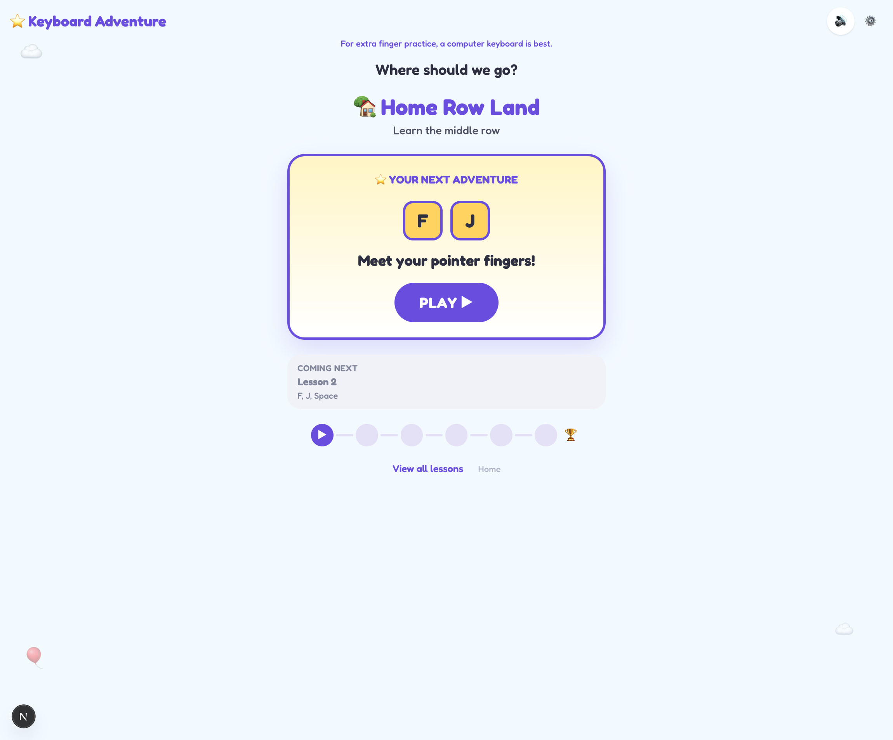
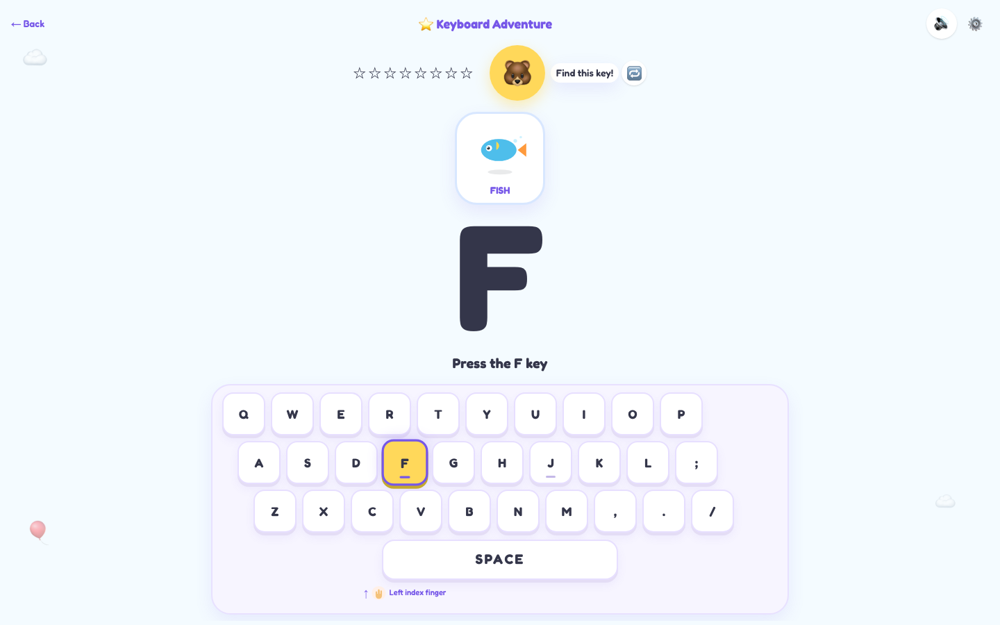
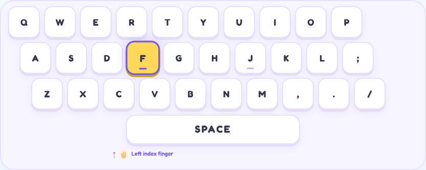
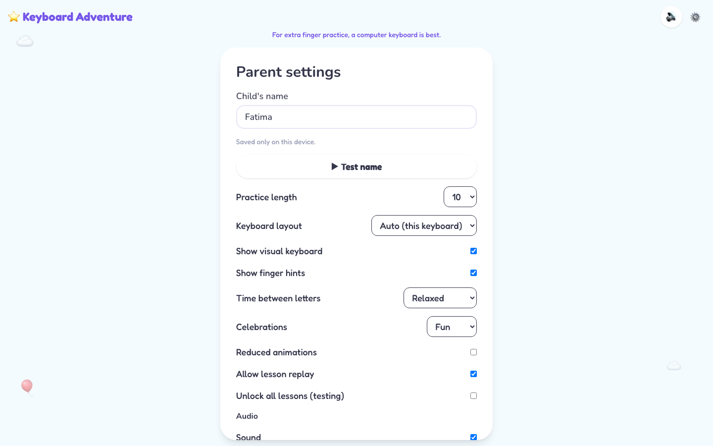
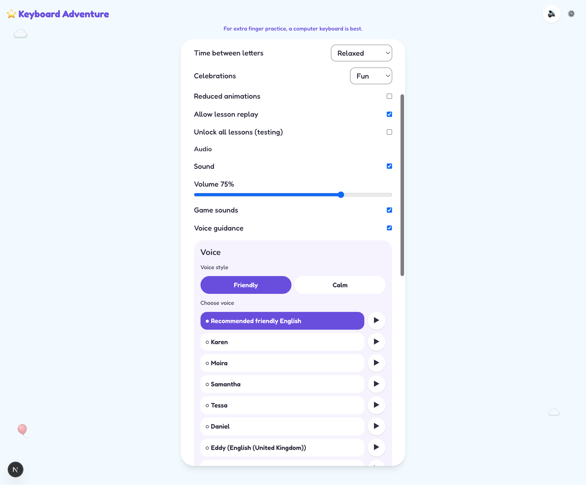
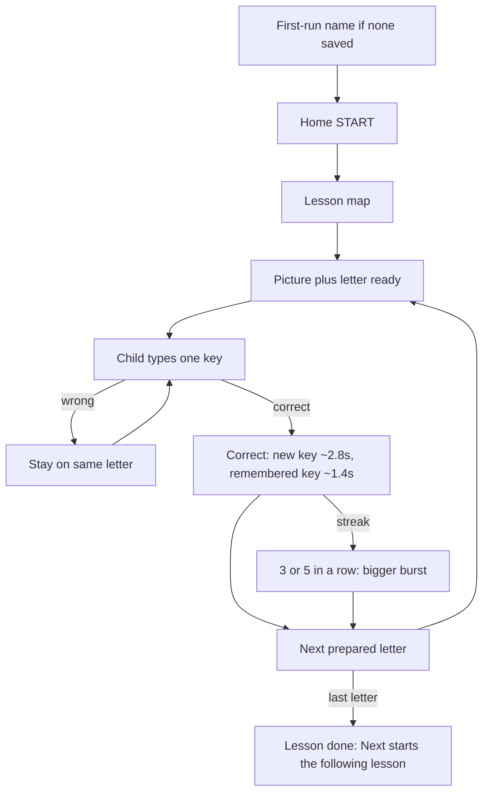

# Keyboard Adventure

A playful typing practice app for children about ages **4–8**. The child sees **one giant letter**, an object that starts with that letter (Fish for F), presses that key, and only then moves on. Wrong keys never skip ahead.

No accounts or ads. The child’s first name and progress stay in the browser (`localStorage`). Vercel Web Analytics records page views and does not include the child’s name. The name is never put in the URL or in SEO text.

## What it looks like

Screenshots live in `docs/screenshots/` so GitHub can show them in this README. They are excluded from the Vercel upload (`.vercelignore`) and are **not** in `public/`, so they are not part of the live website.

Refresh them after UI changes:

```bash
CAPTURE_SCREENSHOTS=1 npx playwright test tests/e2e/capture-screenshots.spec.ts --project=desktop-chromium
```

### First visit

If no name is saved, this screen blocks play. A blank name cannot continue.



### Home



### Lesson map



### Lesson

Fish appears before typing F. The toy keyboard has a long space bar. The finger hint stays on screen under the target key.





### Parent settings

Child’s name (**▶ Test name**), **Keyboard layout** (Auto, English, German, French), Friendly or Calm voice, preview, and speaking speed.







## Install

```bash
cd keyboard-adventure
npm install
```

## Run locally

```bash
npm run dev
```

Open [http://localhost:3000](http://localhost:3000). A computer with a physical keyboard is best for finger practice. Phones use the native keyboard and a compact HUD (no full on-screen QWERTY).

## First visit

If no name is saved, a blocking screen asks **Who is learning today?** A blank name cannot continue. After **LET’S GO!**, the name is stored on this device only. Letters, marks, spaces, hyphens, and apostrophes are allowed. Parent settings can change it later (**▶ Test name**).

## How a lesson works

1. One picture and one giant letter are on screen before the child types.
2. The first time a letter is ever seen, its three pictures play in turn (Fish, then Frog, then Flower), then the child types that letter once.
3. Every later time that letter appears, one other picture stays up (Frog). A key already learned in a finished lesson says **You know this!**
4. Typing stays locked for about **0.5 seconds** while the letter zooms in.
5. Voice names the picture, then asks for the key. The big letter on screen stays **F**. **E** is spoken as **ee**.
6. Only one target is active. Layout never changes what counts as a correct key.
7. First wrong key: sound and shake only. Second: **Almost, Fatima. Find F.** Third: **You can do it, Fatima. Find F.** The picture stays.
8. A correct new key locks typing and celebrates about **2.8 seconds** (**You found F!**). A remembered key celebrates about **1.4 seconds** (**You remembered!**).
9. The next letter appears with its picture already ready. Voice does not talk about the next letter until that scene is on screen.
10. Lesson complete is a **full-screen party**. After a few seconds the app shows what was learned, any remembered keys, **Next: …**, and **Play again**. **Next** starts the following lesson. The app does not leave that screen by itself.

Desktop shows a toy keyboard that still teaches real geography: staggered rows, F/J bumps, and a wide space bar. The finger hint sits under the **target key**, inside the keyboard card.

### Keyboard layout

Parents can leave **Keyboard layout** on **Auto (this keyboard)** (the default). Chrome can read the physical layout map; if that is missing, the first distinctive key (Y/Z or A/Q) can still switch the toy board to German or French. Parents can lock **English**, **German**, or **French**. That only changes the toy keyboard and finger hints. Typing still matches the letter on screen, not the physical key label. A lesson key missing from that layout shows **Find this key**.

### Lessons build on finished keys

The screen stays one picture, one letter, one key. The play list is built in `src/lib/curriculum/sequence.ts`.

| Lesson | What the child types |
| --- | --- |
| 1 | Only F and J, eight turns, opening on F |
| 2 | Space, switching with F and J. Opens and ends on Space |
| 3–5, and later pairs | The new keys are most of eight turns. One or two keys from finished earlier lessons visit in the middle. The first and last turn are new keys |
| 6 | The home-row mix from that lesson’s own sequence |

A key from a later lesson does not appear early. **Play again** keeps the same opening letter and rotates which finished keys visit. The map shows **Old friends may visit** when any will.

Lesson 2 unlocks after lesson 1 is finished, and so on.

### Celebrations

| Moment | Feel |
| --- | --- |
| Correct key | Mixed ✨⭐🌸👍👏🎉 around the letter, slow float, ding, 🐻 clap |
| 3 or 5 in a row | Same mix plus 🥳💖 from several screen areas |
| Lesson finished | Whole-screen mix, balloons, confetti, applause once, **YOU DID IT!** |

Reduced motion (OS or parent setting) keeps a still mix of flowers, stars, thumbs, and clap. No flying pieces.

## Voice

Browser speech cannot request `gender: "female"`. The app prefers clearer English system voices (Samantha Enhanced over Compact, and similar). Rate stays near normal talking speed. Parents can preview and pick a voice in settings.

Howler still plays success, wrong, star, streak, and lesson-complete sounds. Applause on lesson complete plays **once**, not in a loop.

## Add lessons

Edit `src/data/lessons.ts`. Each lesson needs an `id`, `title`, `description`, `keys`, and a `sequence`. Use `" "` for space. `keys` are the letters that lesson is about. When every key was already taught by an earlier lesson, `sequence` is the play order. Otherwise the planner in `src/lib/curriculum/sequence.ts` builds the play list from those keys and lessons already finished.

## Theme and colors

Colors and motion live in `src/app/globals.css`. Fonts are Fredoka (letters) and Nunito (UI) in `src/app/layout.tsx`.

## Checks

```bash
npm run lint
npm run typecheck
npm test
npm run test:e2e
npm run verify
```

`npm run verify` is lint (no warnings), typecheck, coverage, and production build.

## Deploy on Vercel

1. Push this folder to GitHub.
2. Import the repo in Vercel (Next.js defaults).
3. Deploy.

Optional: set `NEXT_PUBLIC_SITE_URL` to the public domain so sitemap, canonical, and Open Graph URLs match production. SEO title, description, robots, sitemap, and JSON-LD are already in the app. They never include the child’s name.

Do **not** copy screenshots into `public/`. GitHub shows `docs/screenshots/` in this README. `.vercelignore` keeps those PNGs out of the Vercel deployment.

## Local progress

These keys are stored only on this device:

- `keyboard-adventure-progress-v1` — completed lessons, stars, attempt counts, letters already introduced
- `keyboard-adventure-settings-v1` — child name, sound, voice, volume, animations, hints, keyboard layout, question count

Parent settings (gear) → **Reset progress** (lessons, stars, stats) or **Reset everything** (also sound, name, and other options). You can also clear this site’s data in the browser. Nothing is sent to a server.

## How matching works

`src/utils/keys.ts` is the only place that decides if a key counts. Matching is case-insensitive. Held-down repeats (`event.repeat`) are ignored. Modifier and arrow keys are ignored. Space is `event.key === " "`.
