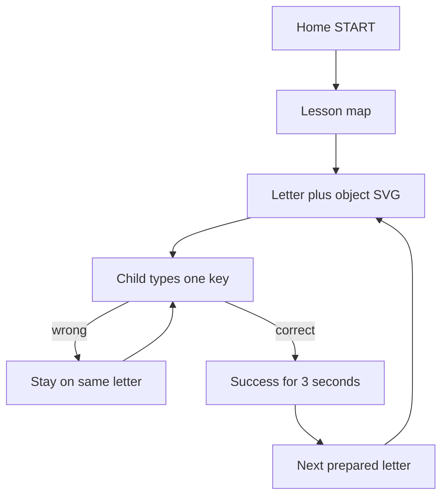

# Keyboard Adventure

A playful typing practice app for children about ages **4–8**. The child sees **one giant letter**, an object that starts with that letter (Fish for F), presses that key on a real keyboard, and only then moves on. Wrong keys never skip ahead. A correct key holds a **success celebration for about 3 seconds** so the child can enjoy “Fantastic! F is for Fish!” before the next letter.

No accounts, ads, analytics, or child data collection. Progress stays in the browser (`localStorage`).

## What it looks like

These captures were taken from a local browser session. They live in `docs/screenshots/` on your machine only. That folder is gitignored so **screenshots are not committed and are not deployed to Vercel**.

| Screen | File (local) | What you should see |
| --- | --- | --- |
| Home | `docs/screenshots/home.png` | Bear mascot, **START**, **Practice** |
| Lesson map | `docs/screenshots/map.png` | Home Row Land, F and J, **PLAY** |
| Lesson | `docs/screenshots/lesson-f.png` | Fish + F, toy QWERTY with a long **SPACE** bar, finger under F |
| Parent settings | `docs/screenshots/parent-settings.png` | Sound, Friendly/Calm voice, preview |



## Install

```bash
cd keyboard-adventure
npm install
```

## Run locally

```bash
npm run dev
```

Open [http://localhost:3000](http://localhost:3000). A computer with a physical keyboard is best for finger practice. Phones use the native keyboard and a compact HUD (no full on-screen QWERTY).

## How a lesson works

1. The association picture and word appear **before** typing (Fish / FISH, then F).
2. Only one target is active. Layout never changes what counts as a correct key.
3. Wrong keys shake and stay. The picture does not disappear.
4. Correct keys lock typing, celebrate, keep the same picture, then wait at least **3000ms**.
5. The next letter appears with its picture already ready. Voice does not say the next letter until that scene is on screen.
6. Lesson complete waits for **Next adventure** or **Play again**.

Desktop shows a toy keyboard that still teaches real geography: staggered rows, F/J bumps, and a wide space bar. The finger hint sits under the **target key**, not under Space.

## Voice

Browser speech synthesis cannot request `gender: "female"`. The app ranks English voices on the device and prefers known friendly names (Samantha, Ava, Zira, and similar) when they exist. Parents can preview and pick a voice, choose Friendly or Calm, and set speed from Slow to Cheerful. Pitch stays warm (about 1.12–1.15), not squeaky.

Howler still plays success, wrong, star, and celebration sounds. Speech is behind a replaceable provider so a later neural TTS voice can replace the browser fallback.

## Add lessons

Edit `src/data/lessons.ts`. Each lesson needs an `id`, `title`, `description`, `keys`, and a `sequence` of target characters (`" "` for space).

Lesson 2 unlocks after lesson 1 is finished, and so on.

## Theme and colors

Colors and motion live in `src/app/globals.css`. Fonts are Fredoka (letters) and Nunito (UI) in `src/app/layout.tsx`.

## Checks

```bash
npm run typecheck
npm test
npm run test:e2e
npm run verify
```

## Deploy on Vercel

1. Push this folder to GitHub.
2. Import the repo in Vercel (Next.js defaults).
3. Deploy. No environment variables are required.

Vercel only serves the Next.js app (pages, `public/`, built assets). Do **not** put screenshots in `public/`. Local captures in `docs/screenshots/` stay off the live site.

## Local progress

These keys are stored only on this device:

- `keyboard-adventure-progress-v1` — completed lessons, stars, attempt counts
- `keyboard-adventure-settings-v1` — sound, voice, volume, animations, hints, question count

Parent settings (gear) → **Reset progress** (lessons, stars, stats) or **Reset everything** (also sound, name, and other options). You can also clear this site’s data in the browser. Nothing is sent to a server.

## How matching works

`src/utils/keys.ts` is the only place that decides if a key counts. Matching is case-insensitive. Held-down repeats (`event.repeat`) are ignored. Modifier and arrow keys are ignored. Space is `event.key === " "`.
